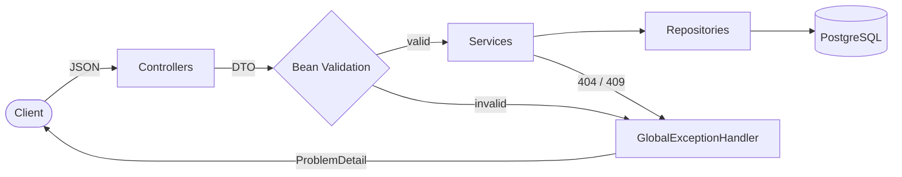
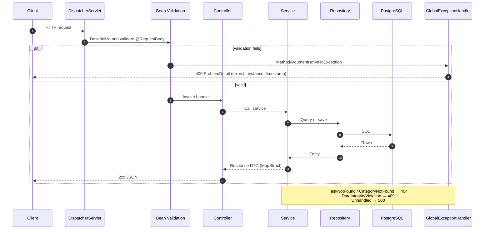

# Task Manager API

REST API for managing tasks and categories, built with Spring Boot and PostgreSQL.

**English | [繁體中文](README.zh-TW.md)**

## Features

- Task create, read, update, and soft delete.
- Category create and read with unique names.
- Task list filtering by title (case-insensitive substring) and completion status.
- Pagination and sorting.
- Bean Validation and RFC 9457 `ProblemDetail` error responses.
- OpenAPI/Swagger UI in `dev` (disabled in `prod`).
- PostgreSQL schema managed by Flyway; Hibernate validates it at startup.
- `dev` / `prod` profiles and Actuator health/info endpoints.

## Tech Stack

| Area | Technology |
|---|---|
| Runtime | Java 25 |
| Framework | Spring Boot 4.1.0 (Spring MVC, Spring Data JPA / Hibernate) |
| Database | PostgreSQL, Flyway |
| Mapping | MapStruct 1.6.3, Lombok |
| Validation | Jakarta Bean Validation (Hibernate Validator) |
| Observability | Spring Boot Actuator |
| API docs | springdoc-openapi 3.1.1 (Swagger UI) |
| Build | Maven Wrapper 3.9.16 |

## Architecture

### High-level view



Controllers handle HTTP and DTO validation. Services own transactions and business rules. Repositories use Spring Data JPA and Specifications. `GlobalExceptionHandler` maps errors to RFC 9457 `ProblemDetail` responses.

### Request flow



Solid arrows are calls; dashed arrows are returns or errors. The `alt`/`else` block is the validation branch, and the note lists the error statuses produced by the service and handler.

## Quick Start

Prerequisites: JDK 25 and Docker for PostgreSQL. The Maven wrapper is included. Run all commands from the repository root.

1. Configure the database environment:

```bash
cp .env.example .env
# Edit the POSTGRES_* values in .env.
```

2. Start PostgreSQL:

```bash
docker compose up -d
```

3. Make the same variables available to the application. The application does not read `.env` by itself.

**IntelliJ IDEA (EnvFile plugin):**

- Install the EnvFile plugin if it is not already installed.
- Open Run/Debug Configurations for `TaskmanagerApplication`.
- Check **Enable EnvFile**, add the project `.env` file, and check it.
- Run the configuration.

**Terminal (macOS/Linux):**

```bash
set -a
source .env
set +a
```

Then run the application in the same shell.

4. Run the application:

```bash
./mvnw spring-boot:run
```

The `dev` profile is active by default. The API and Actuator listen on port 8080.

5. Verify:

```bash
curl http://localhost:8080/actuator/health
```

6. Open the Swagger UI (dev only): [http://localhost:8080/swagger-ui.html](http://localhost:8080/swagger-ui.html).

## Configuration

| Setting | `dev` (default) | `prod` |
|---|---|---|
| Activation | default | `SPRING_PROFILES_ACTIVE=prod` |
| Datasource | `POSTGRES_*` with defaults | `POSTGRES_*` required |
| SQL logging | enabled | disabled |
| Log level | root `INFO`, app `DEBUG` | root `WARN`, app `INFO` |
| Log output | console | `logs/taskmanager-prod.log` |
| Actuator exposure | all endpoints | `health, info` |
| Health details | always | never |
| `app.max-tasks-per-page` | 15 | 50 |
| `springdoc.api-docs.enabled` | `true` | `false` |
| `springdoc.swagger-ui.enabled` | `true` | `false` |

Environment variables: `POSTGRES_HOST`, `POSTGRES_PORT`, `POSTGRES_DB`, `POSTGRES_USER`, `POSTGRES_PASSWORD`. See `.env.example`.

Docker Compose reads `POSTGRES_*` from `.env`; Spring Boot reads the same variables from its process environment and otherwise falls back to the defaults in `application-dev.yml`. If you change a value in `.env`, use the same value in `application-dev.yml` or pass it to the application.

- Default port: 8080. Actuator base path: `/actuator`.
- JPA: `ddl-auto: validate`. Flyway: `baseline-on-migrate: false`, baseline version `20261119084647`.

> **Note:** `app.max-tasks-per-page` is reported by `GET /api/v1/app-info`; it is not enforced as a page-size cap. Spring Data's default maximum page size (2000) applies.

Swagger/OpenAPI is enabled in `dev` and disabled in `prod`.

## API

Base path: `/api/v1`.

| Method | Path | Purpose | Success |
|---|---|---|---|
| GET | `/api/v1/tasks` | List/search tasks | 200 `Page<TaskResponse>` |
| GET | `/api/v1/tasks/{id}` | Get one task | 200 |
| POST | `/api/v1/tasks` | Create a task | 201 |
| PATCH | `/api/v1/tasks/{id}` | Partially update a task | 200 |
| DELETE | `/api/v1/tasks/{id}` | Soft-delete a task | 204 |
| GET | `/api/v1/categories/{id}` | Get one category | 200 |
| POST | `/api/v1/categories` | Create a category | 201 |
| GET | `/api/v1/app-info` | App metadata | 200 |

### Interactive documentation

In `dev`, springdoc exposes:

- [Swagger UI](http://localhost:8080/swagger-ui.html) — interactive browser UI for exploring and calling the API.
- [OpenAPI JSON](http://localhost:8080/v3/api-docs) — machine-readable spec for tools such as Postman.
- [OpenAPI YAML](http://localhost:8080/v3/api-docs.yaml) — the same spec in YAML for humans and CI.

Swagger/OpenAPI is enabled only in `dev`; `prod` disables it.

### Task list parameters

| Parameter | Type | Default | Notes |
|---|---|---|---|
| `title` | string | none (no filter) | Case-insensitive substring match |
| `completed` | boolean | none (no filter) | Exact match |
| `page` | integer | `0` | Zero-based page index |
| `size` | integer | `10` | Page size |
| `sort` | string | `createdAt,desc` | `field,direction`, e.g. `sort=title,asc` |

The response is Spring Data's `Page` JSON with `content`, `totalElements`, `totalPages`, `number`, `size`, `sort`, `first`, `last`, `numberOfElements`, and `empty`.

`completed` has no request default: it is required on create, unchanged when omitted on PATCH, and not filtered when omitted from the list query.

### Examples

The examples are curl commands; Postman can import them via **Import → Raw text**.

Create a category:

```bash
curl -s -X POST http://localhost:8080/api/v1/categories -H 'Content-Type: application/json' -d '{"name":"Work","description":"Work-related tasks"}'
```

Create a task:

```bash
curl -s -X POST http://localhost:8080/api/v1/tasks -H 'Content-Type: application/json' -d '{"title":"Write README","description":"Draft the project README","completed":false,"categoryId":1}'
```

Patch a task:

```bash
curl -s -X PATCH http://localhost:8080/api/v1/tasks/1 -H 'Content-Type: application/json' -d '{"completed":true,"description":""}'
```

### Semantics

- `POST /tasks` requires `title`, `completed`, and `categoryId`.
- `PATCH /tasks/{id}` updates only supplied fields. Omitting a field or sending JSON `null` leaves it unchanged.
- `description: ""` or whitespace-only clears the description to `null`.
- `title`, if supplied, must be 2–100 characters and not blank (Unicode whitespace is rejected).
- `categoryId`, if supplied, must reference an existing category; otherwise 404. A category cannot be unassigned.
- An empty PATCH object (`{}`) returns 200 with the task unchanged.
- `DELETE` is a soft delete (`tasks.deleted = true`). Later GET, list, PATCH, and DELETE requests return 404.
- Category names are unique (case-sensitive); a duplicate create returns 409.
- Unknown tasks or categories return 404.

Validation limits: task `title` 2–100, task `description` ≤500; category `name` 1–20, category `description` ≤300.

## Error Contract

Errors use `Content-Type: application/problem+json` and follow RFC 9457.

| Field | Description |
|---|---|
| `type` | Problem type URI; defaults to `about:blank` |
| `title` | Short summary |
| `status` | HTTP status code |
| `detail` | Human-readable explanation |
| `instance` | Request path |
| `timestamp` | Server-local timestamp (extension) |
| `errors` | Validation errors: `[{"field": "...", "message": "..."}]` |

| Status | When |
|---|---|
| 400 | Validation failure, malformed JSON, parameter type mismatch, missing body |
| 404 | Unknown task, category, or path |
| 405 | Unsupported HTTP method |
| 409 | Data integrity conflict (for example, a duplicate category name) |
| 415 | Unsupported media type |
| 500 | Unexpected server error |

Example 400 response:

```json
{
  "type": "about:blank",
  "title": "Bad Request",
  "status": 400,
  "detail": "Validation Failed",
  "instance": "/api/v1/tasks",
  "timestamp": "2026-11-25T12:00:00",
  "errors": [
    { "field": "completed", "message": "Completed is mandatory" }
  ]
}
```

## Database and Migrations

Flyway migrations live in `src/main/resources/db/migration`. Hibernate runs with `ddl-auto: validate`, so migrations are the schema source of truth.

**`categories`**

| Column | Type | Constraints |
|---|---|---|
| `id` | `bigint` | Primary key, identity |
| `name` | `varchar(255)` | `NOT NULL`, unique |
| `description` | `varchar(300)` | Nullable |

**`tasks`**

| Column | Type | Constraints |
|---|---|---|
| `id` | `bigint` | Primary key, identity |
| `title` | `varchar(100)` | `NOT NULL` |
| `description` | `varchar(500)` | Nullable |
| `completed` | `boolean` | `NOT NULL` |
| `created_at` | `timestamp` | `NOT NULL`, set on insert |
| `category_id` | `bigint` | FK → `categories(id)`, nullable |
| `deleted` | `boolean` | `NOT NULL`, default `false`; soft-delete flag |

Soft delete is implemented with Hibernate `@SoftDelete`; `DELETE /tasks/{id}` sets `deleted = true`, and JPA reads exclude deleted rows.

## Project Structure

```
.
├── pom.xml
├── docker-compose.yaml
├── .env.example
└── src/main/
    ├── java/com/andy/taskmanager/
    │   ├── controller/   HTTP endpoints
    │   ├── service/      transactions and business rules
    │   ├── repository/   Spring Data JPA (+ specification/)
    │   ├── entity/       JPA entities
    │   ├── dto/          request and response records
    │   ├── mapper/       MapStruct mappers
    │   ├── exception/    custom exceptions and the global handler
    │   └── config/       typed configuration properties
    └── resources/
        ├── application.yml
        ├── application-dev.yml
        ├── application-prod.yml
        └── db/migration/ Flyway migrations
```
