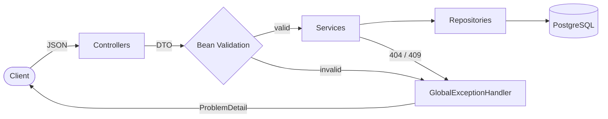
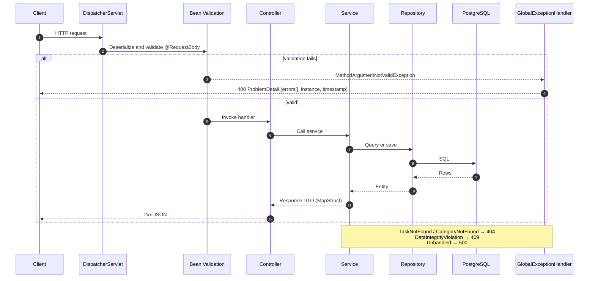

# Task Manager API

以 Spring Boot 與 PostgreSQL 建置的任務與分類管理 REST API。

**[English](README.md) | 繁體中文**

## 功能

- 任務建立、讀取、更新與軟刪除（soft delete）。
- 分類建立與讀取；分類名稱唯一。
- 任務列表可依標題（不分大小寫的子字串）與完成狀態篩選。
- 支援分頁（pagination）與排序。
- Bean Validation 與 RFC 9457 `ProblemDetail` 錯誤回應。
- `dev` 環境提供 OpenAPI/Swagger UI（`prod` 關閉）。
- PostgreSQL schema 由 Flyway 管理；Hibernate 啟動時驗證 schema。
- `dev` / `prod` profiles 與 Actuator health/info。

## 技術棧

| 領域 | 技術 |
|---|---|
| 執行環境 | Java 25 |
| 框架 | Spring Boot 4.1.0（Spring MVC、Spring Data JPA / Hibernate） |
| 資料庫 | PostgreSQL、Flyway |
| 映射 | MapStruct 1.6.3、Lombok |
| 驗證 | Jakarta Bean Validation（Hibernate Validator） |
| 可觀測性 | Spring Boot Actuator |
| API 文件 | springdoc-openapi 3.1.1（Swagger UI） |
| 建置 | Maven Wrapper 3.9.16 |

## 架構

### 高階檢視



Controller 處理 HTTP 與 DTO 驗證；Service 負責交易與商業規則；Repository 使用 Spring Data JPA 與 Specification；`GlobalExceptionHandler` 將錯誤轉成 RFC 9457 `ProblemDetail`。

### 請求流程



實線箭頭是呼叫，虛線箭頭是回傳或錯誤；`alt`/`else` 是驗證成功與失敗的分支；`Note` 列出 service 與 handler 產生的錯誤狀態。

## 快速開始

需求：JDK 25，以及用於 PostgreSQL 的 Docker。專案已包含 Maven wrapper。以下指令都在專案根目錄執行。

1. 設定資料庫環境變數：

```bash
cp .env.example .env
# 編輯 .env 的 POSTGRES_* 值。
```

2. 啟動 PostgreSQL：

```bash
docker compose up -d
```

3. 讓應用程式取得同一組變數。應用程式不會自己讀取 `.env`。

**IntelliJ IDEA（EnvFile plugin）：**

- 若尚未安裝，先安裝 EnvFile plugin。
- 開啟 `TaskmanagerApplication` 的 Run/Debug Configurations。
- 勾選 **Enable EnvFile**，加入專案的 `.env`，並勾選它。
- 執行設定。

**終端機（macOS/Linux）：**

```bash
set -a
source .env
set +a
```

然後在同一個 shell 啟動應用程式。

4. 啟動應用程式：

```bash
./mvnw spring-boot:run
```

預設啟用 `dev` profile；API 與 Actuator 都監聽 8080。

5. 驗證：

```bash
curl http://localhost:8080/actuator/health
```

6. 開啟 Swagger UI（僅 dev）：[http://localhost:8080/swagger-ui.html](http://localhost:8080/swagger-ui.html)。

## 設定

| 設定 | `dev`（預設） | `prod` |
|---|---|---|
| 啟用方式 | 預設 | `SPRING_PROFILES_ACTIVE=prod` |
| 資料源 | `POSTGRES_*`（有預設值） | `POSTGRES_*` 必填 |
| SQL logging | 開啟 | 關閉 |
| 日誌等級 | root `INFO`、app `DEBUG` | root `WARN`、app `INFO` |
| 日誌輸出 | console | `logs/taskmanager-prod.log` |
| Actuator 暴露 | 全部 endpoint | `health, info` |
| Health 詳細資訊 | always | never |
| `app.max-tasks-per-page` | 15 | 50 |
| `springdoc.api-docs.enabled` | `true` | `false` |
| `springdoc.swagger-ui.enabled` | `true` | `false` |

環境變數：`POSTGRES_HOST`、`POSTGRES_PORT`、`POSTGRES_DB`、`POSTGRES_USER`、`POSTGRES_PASSWORD`。請參考 `.env.example`。

Docker Compose 從 `.env` 讀取 `POSTGRES_*`；Spring Boot 從執行環境讀取同一組變數，沒有時使用 `application-dev.yml` 的預設值。若你改了 `.env` 的值，請在 `application-dev.yml` 使用相同的值，或把變數帶進 app 的執行環境。

- 預設 port：8080。Actuator base path：`/actuator`。
- JPA：`ddl-auto: validate`。Flyway：`baseline-on-migrate: false`，baseline version `20261119084647`。

> **注意：** `app.max-tasks-per-page` 只由 `GET /api/v1/app-info` 回報，並未實際限制 page size。Spring Data 預設最大 page size（2000）仍然生效。

Swagger/OpenAPI 只在 `dev` 開啟，`prod` 關閉。

## API

Base path：`/api/v1`。

| Method | Path | 用途 | 成功狀態 |
|---|---|---|---|
| GET | `/api/v1/tasks` | 列表／搜尋任務 | 200 `Page<TaskResponse>` |
| GET | `/api/v1/tasks/{id}` | 取得單一任務 | 200 |
| POST | `/api/v1/tasks` | 建立任務 | 201 |
| PATCH | `/api/v1/tasks/{id}` | 部分更新任務 | 200 |
| DELETE | `/api/v1/tasks/{id}` | 軟刪除任務 | 204 |
| GET | `/api/v1/categories/{id}` | 取得單一分類 | 200 |
| POST | `/api/v1/categories` | 建立分類 | 201 |
| GET | `/api/v1/app-info` | 應用程式 metadata | 200 |

### 互動式文件

`dev` 環境提供：

- [Swagger UI](http://localhost:8080/swagger-ui.html) — 瀏覽器互動介面，可直接瀏覽與試打 API。
- [OpenAPI JSON](http://localhost:8080/v3/api-docs) — 給工具讀的規格，例如 Postman 匯入。
- [OpenAPI YAML](http://localhost:8080/v3/api-docs.yaml) — 同一份規格的 YAML 版本，適合人看與 CI。

Swagger/OpenAPI 只在 `dev` 開啟，`prod` 關閉。

### 任務列表參數

| 參數        | 型別    | 預設             | 說明                                     |
|-------------|---------|------------------|------------------------------------------|
| `title`     | string  | 無（不篩選）     | 不分大小寫的模糊搜尋                     |
| `completed` | boolean | 無（不篩選）     | 精確比對                                 |
| `page`      | integer | `0`              | 從 0 開始的頁碼                          |
| `size`      | integer | `10`             | 每頁筆數                                 |
| `sort`      | string  | `createdAt,desc` | `field,direction`，例如 `sort=title,asc` |

回應是 Spring Data 的 `Page` JSON，包含 `content`、`totalElements`、`totalPages`、`number`、`size`、`sort`、`first`、`last`、`numberOfElements`、`empty`。

`completed` 沒有請求預設值：建立時必填、PATCH 省略時不變更、列表查詢省略時不篩選。

### 範例

範例是 curl 指令；Postman 可用 **Import → Raw text** 匯入。

建立分類：

```bash
curl -s -X POST http://localhost:8080/api/v1/categories -H 'Content-Type: application/json' -d '{"name":"Work","description":"Work-related tasks"}'
```

建立任務：

```bash
curl -s -X POST http://localhost:8080/api/v1/tasks -H 'Content-Type: application/json' -d '{"title":"Write README","description":"Draft the project README","completed":false,"categoryId":1}'
```

部分更新任務：

```bash
curl -s -X PATCH http://localhost:8080/api/v1/tasks/1 -H 'Content-Type: application/json' -d '{"completed":true,"description":""}'
```

### 行為語意

- `POST /tasks` 需要 `title`、`completed`、`categoryId`。
- `PATCH /tasks/{id}` 只更新有帶的欄位。省略欄位或送 JSON `null` 都不會變更。
- `description: ""` 或全空白會把描述清成 `null`。
- `title` 若有帶，長度需 2–100 且不可為空白（含 Unicode 空白）。
- `categoryId` 若有帶，必須指向存在的分類，否則 404。分類無法被清空。
- 空的 PATCH object（`{}`）回 200，任務不變。
- `DELETE` 是軟刪除（`tasks.deleted = true`）。之後的 GET、PATCH、DELETE 都會回 404，列表回應會排除該任務。
- 分類名稱唯一（區分大小寫）；重複建立回 409。
- 任務或分類不存在回 404。

驗證限制：任務 `title` 2–100、`description` ≤500；分類 `name` 1–20、`description` ≤300。

## 錯誤契約

錯誤回應使用 `Content-Type: application/problem+json`，遵循 RFC 9457。

| 欄位 | 說明 |
|---|---|
| `type` | 問題類型 URI；預設 `about:blank` |
| `title` | 簡短摘要 |
| `status` | HTTP status code |
| `detail` | 可讀的說明 |
| `instance` | 請求路徑 |
| `timestamp` | 伺服器本地時間（extension） |
| `errors` | 驗證錯誤：`[{"field": "...", "message": "..."}]` |

| Status | 時機 |
|---|---|
| 400 | 驗證失敗、JSON 格式錯誤、參數型別錯誤、缺少 body |
| 404 | 任務、分類或路徑不存在 |
| 405 | 不支援的 HTTP method |
| 409 | 資料完整性衝突（例如分類名稱重複） |
| 415 | 不支援的 media type |
| 500 | 未預期的伺服器錯誤 |

400 範例：

```json
{
  "type": "about:blank",
  "title": "Bad Request",
  "status": 400,
  "detail": "Validation Failed",
  "instance": "/api/v1/tasks",
  "timestamp": "2026-11-25T12:00:00",
  "errors": [
    { "field": "completed", "message": "Completed is mandatory" }
  ]
}
```

## 資料庫與遷移

Flyway migrations 位於 `src/main/resources/db/migration`。Hibernate 使用 `ddl-auto: validate`，因此 migration 是 schema 的唯一來源。

**`categories`**

| 欄位 | 型別 | 限制 |
|---|---|---|
| `id` | `bigint` | 主鍵、identity |
| `name` | `varchar(255)` | `NOT NULL`、唯一 |
| `description` | `varchar(300)` | 可為 null |

**`tasks`**

| 欄位 | 型別 | 限制 |
|---|---|---|
| `id` | `bigint` | 主鍵、identity |
| `title` | `varchar(100)` | `NOT NULL` |
| `description` | `varchar(500)` | 可為 null |
| `completed` | `boolean` | `NOT NULL` |
| `created_at` | `timestamp` | `NOT NULL`、寫入時設定 |
| `category_id` | `bigint` | FK → `categories(id)`、可為 null |
| `deleted` | `boolean` | `NOT NULL`、預設 `false`、軟刪除標記 |

軟刪除由 Hibernate `@SoftDelete` 實作；`DELETE /tasks/{id}` 會設定 `deleted = true`，JPA 讀取時自動排除。

## 專案結構

```
.
├── pom.xml
├── docker-compose.yaml
├── .env.example
└── src/main/
    ├── java/com/andy/taskmanager/
    │   ├── controller/   HTTP endpoints
    │   ├── service/      交易與商業規則
    │   ├── repository/   Spring Data JPA（+ specification/）
    │   ├── entity/       JPA entities
    │   ├── dto/          request/response records
    │   ├── mapper/       MapStruct mappers
    │   ├── exception/    自訂例外與全域 handler
    │   └── config/       typed configuration properties
    └── resources/
        ├── application.yml
        ├── application-dev.yml
        ├── application-prod.yml
        └── db/migration/ Flyway migrations
```
